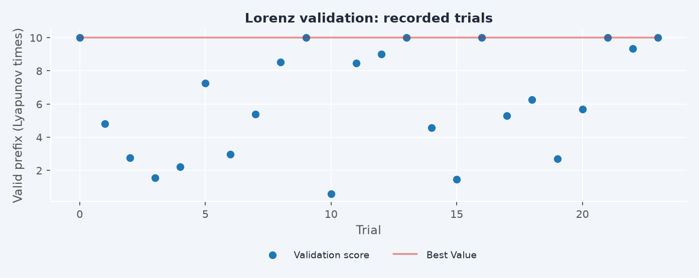
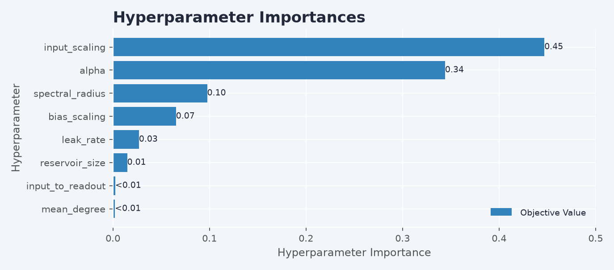
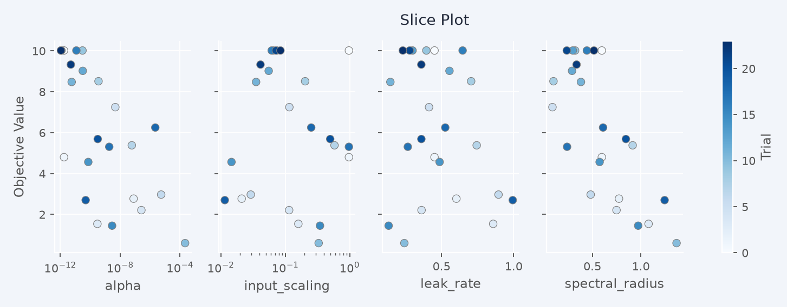
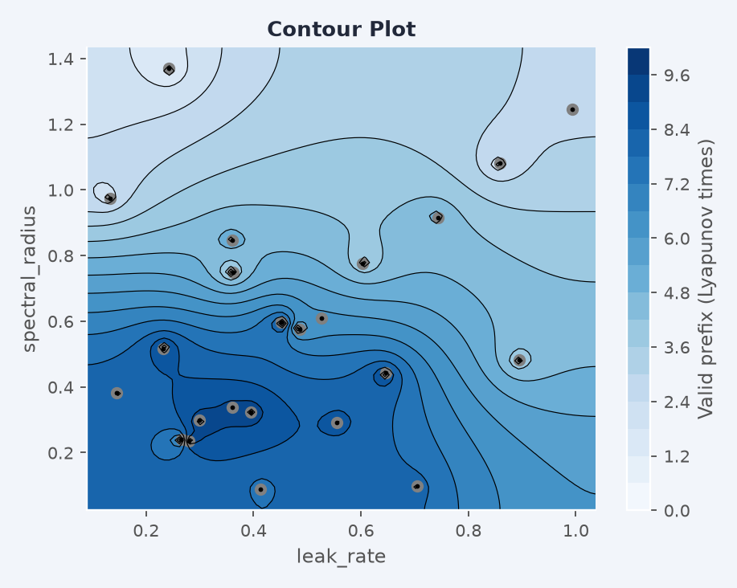

<span class="nb-kicker">Advanced</span>

# Raw HPO runner

Use this lower-level runner when you want to prepare every training and
forecast tensor yourself and build raw `ESNModel` graphs. The usual
[`model.tune(...)` workflow](../workflows/tune.md) handles chronological
validation, preprocessing, named ports and installing a fitted winner.
`run_hpo` returns an Optuna study and leaves winner reconstruction to you.
Both workflows use the same managed joblib executor and parent-owned Optuna
bookkeeping. This raw entry point keeps its explicit data and loss contracts.

## Parameters to explore

Useful search dimensions include:

| Parameter | Controls | Range | First move |
| --- | --- | --- | --- |
| `reservoir_size` | model capacity | 100–2000 | double it until gains stall |
| `spectral_radius` | memory horizon, stability | 0.8–1.2 | sweep ±0.1 around 0.9 |
| `leak_rate` | state update timescale | 0.05–1.0 | lower it for slow signals |
| `bias_scaling` | diversity of unit operating points | 0.0–2.0 | leave at 1.0; `0.0` recovers a zero-bias reservoir |
| `topology` | recurrent connectivity structure | registry names | default (dense random) first, graphs after |
| `feedback_initializer` | how the signal enters | registry names | default first; scale before structure |
| `alpha` | readout ridge regularization | 1e-8–1e-2 | step by ×100 on a log scale |
| warmup length | state synchronization | 100–500 steps | raise it until forecasts stop changing |

**Spectral radius** scales the recurrent matrix so its largest eigenvalue
magnitude hits the target, which sets how long an input echoes through
the state. Small values forget fast and stay stable; values near one
remember longer and produce richer transients at the edge of instability
— for driven, leaky reservoirs the best value often sits slightly above
1.0. Factories default to 0.9; a bare `ESNLayer` leaves the matrix unscaled
unless you pass a value.

**Leak rate** blends the previous state into the new one:
$x_t = (1-a)\,x_{t-1} + a\,\tilde{x}_t$. At `1.0` the state is fully
replaced each step (the standard ESN); smaller values integrate slowly,
matching the reservoir's timescale to the signal's. Slow, smooth signals
call for small leak rates; `leak_rate=0.1` with a spectral radius near
1.0 is a standard configuration for long-period oscillations.

**Alpha** sets the bias–variance tradeoff of a ridge readout such as
`CGReadoutLayer`. Too small, and the readout amplifies state noise and
forecasts diverge within a few steps; too large, and predictions
over-smooth toward the mean. The optimum shifts with reservoir size and
training length, which is why it belongs in every search space.

---

## Searching with `run_hpo`

Three callables define a study: a model factory, a search space, and a
data loader. Each trial builds a fresh model, fits the readout, forecasts
over the validation window, and scores it.

<div class="nb-specimen" data-label="study.py" markdown>

```python
import torch
import resdag as rd
from resdag.hpo import run_hpo

t = torch.arange(2300, dtype=torch.float32) / 20
data = torch.sin(t[:, None] * torch.tensor([0.7, 1.0, 1.3]))[None]
# data has shape (1, 2300, 3): batch, time, features
warmup, train, target, f_warmup, val = rd.utils.prepare_esn_data(
    data, warmup_steps=200, train_steps=1600, val_steps=300
)

def model_creator(reservoir_size, spectral_radius, leak_rate, alpha, seed=None):
    """One fresh model per trial. Must accept every key of search_space."""
    return rd.classic_esn(
        reservoir_size=reservoir_size, feedback_size=3, output_size=3,
        spectral_radius=spectral_radius, leak_rate=leak_rate,
        readout_alpha=alpha, seed=seed,
    )

def search_space(trial):
    return {
        "reservoir_size": trial.suggest_int("reservoir_size", 100, 500, step=100),
        "spectral_radius": trial.suggest_float("spectral_radius", 0.5, 1.2),
        "leak_rate": trial.suggest_float("leak_rate", 0.2, 1.0),
        "alpha": trial.suggest_float("alpha", 1e-8, 1e-2, log=True),
    }

def data_loader(trial):
    """Must include these five keys, each (batch, time, features)."""
    return {"warmup": warmup, "train": train, "target": target,
            "f_warmup": f_warmup, "val": val}

study = run_hpo(
    model_creator=model_creator,
    search_space=search_space,
    data_loader=data_loader,
    n_trials=100,
    loss="efh",
    seed=42,
    storage="study.log",                    # journal file: resumable
)
print(study.best_params)
```

</div>

The data contract is validated per trial: the dict must contain
`"warmup"`, `"train"`, `"target"`, `"f_warmup"`, `"val"`, all 3-D
tensors. The forecast horizon defaults to `val.shape[1]`. Input-driven
models add `drivers_keys=["driver"]` and supply `warmup_driver`,
`train_driver`, `f_warmup_driver`, and `forecast_driver` entries — the
last one sliced with the [pinned alignment](../workflows/forecast.md).

!!! note "Invalid trials and debugging"
    `catch_exceptions=True` continues after an invalid evaluation, but the
    default `error_policy="fail"` records it as an Optuna `FAIL` trial so it
    cannot win. Details remain in the trial's `"error"` attribute. A study
    with no valid completed evaluation raises clearly. Pass
    `catch_exceptions=False` to see the original exception immediately.
    The explicit `error_policy="penalty"` records numeric penalties;
    it still cannot return an invalid winner. Low-level `TrialRunner` and
    `build_objective` have a penalty default: pass `error_policy="fail"` when
    driving those helpers directly. If every attempt is pruned, the returned
    study has no best trial.

The actual forwarded model seed is recorded as `trial.user_attrs["model_seed"]`
when the creator accepts a seed; `"trial_seed"` records the trial RNG seed.
Use that model seed when reconstructing the winner. Forecast evaluation uses
temporary evaluation mode, restoring each module's earlier training flag.

### Resume and reuse settings

`n_trials` is the number of **new attempts in this call**. Failed and pruned
attempts count too. Running with the same storage and study name adds that
many attempts; it does not mean a target total study length. For example,
`n_trials=10` followed by `n_trials=5` creates 15 attempts.

Use prior results as starting settings for a new experiment:

```python
from resdag.hpo import export_best_config

best = export_best_config(study)
next_study = run_hpo(
    model_creator, search_space, data_loader, n_trials=10,
    transfer_from=study, seed=42, verbosity=0,
)
```

`transfer_from` queues complete settings for **re-evaluation** by default.
Single-objective sources are queued best-first, with trial number breaking
ties. Multi-objective sources retain their source order. Suggestions used
only by `data_loader` and fixed model values are preserved; nothing is
silently dropped to make an old score fit a different model. Queued
configurations consume new attempts when evaluated. Remaining configurations
stay `WAITING` if the new budget is smaller than the queue.

`warm_start=[best]` queues specific settings. `export_best_config` includes
fixed model settings alongside suggestions. The destination factory must
accept its model settings; adapt a configuration explicitly if changing
architectures. Trial attributes record full resolved settings and source
study/trial provenance under `"resdag_transfer"`.

Copying old scores requires the explicit `transfer_mode="scores"` and an
identical bound task protocol, including data, validation, objective and
settings. Raw resume and score import replay each historical configuration's
data preparation with Optuna's `FixedTrial` and compare the actual prepared
tensor contents. A changed file loaded by the same callback/path is rejected
before its old scores can compete. Use a fresh study with settings reuse for
changed tasks.

If a data callback needs live-study resources that `FixedTrial` cannot replay,
supply `task_context="my-dataset-v3"` (or a portable metadata mapping). This is
an explicit assertion of the external resources' identity; change it whenever
those resources change. A successful replay still checks tensor contents.
Callbacks may run again for historical validation on resume, so keep data
preparation free of side effects. New attempts receive a real Optuna `Trial`.

### Losses

| Key | Behavior |
| --- | --- |
| `"efh"` | Expected forecast horizon — soft survival sum (default, chaotic systems) |
| `"forecast_horizon"` | Hard count of contiguous below-threshold steps |
| `"lyapunov"` | Error weighted by $e^{-t/\tau}$ with `lyapunov_t` |
| `"standard"` | Mean geometric-mean error — stable or periodic signals |
| `"soft_horizon"` | Hill-gated survival horizon — smoother search landscape |
| `"attractor_dimension"` | Correlation-dimension mismatch for long-term attractor fidelity |

All are minimized; the horizon losses are negated internally, so lower
study values mean longer usable forecasts. `loss_params` passes kwargs
(thresholds, metrics) to the chosen loss; `monitor_losses=["standard"]`
logs extra metrics on every trial without optimizing on them.

With `torch_scoring=True` (the default), the five horizon/error losses score
directly on the forecast device; each checkpoint transfers only its final
scalar. The attractor-dimension loss uses NumPy. Custom losses can accept torch
tensors for the same device-local path, or use the automatic NumPy fallback.
Forecasts are generated in chunks. Checkpoint pruning stops future generation
as soon as the parent pruner rejects a growing prefix. Reports use 1-based
checkpoint indices, not physical sample counts. Raw losses retain their existing
prefix-dependent normalization, so raw scoring can keep a complete prediction
prefix in memory: **O(horizon)** storage. Custom/monitor losses receive the
same full-horizon tensors when an evaluation completes.

### Multi-worker studies

```python
study = run_hpo(..., n_trials=200, n_workers=8, storage="study.log", seed=42)
```

One worker runs in the caller; multiple workers use managed joblib/loky
processes. Notebook factories and loss closures work through joblib's standard
serialization. Search-space functions, data loaders, user trial callbacks,
samplers, pruners and storage all remain in the parent. Numerical workers
receive prepared data and return scores/diagnostics, with no study connection.
In-memory studies therefore also work with multiple workers.

Submission uses finite windows, so failures and pruning cannot overshoot the
new-attempt budget. On errors or interruption, outstanding work is canceled
through joblib and this call's unfinished reservations are marked `FAIL`.
Successfully completed pools follow joblib's normal reuse policy. Journal and
SQLite storage are optional persistence choices; SQLite URLs use normal
SQLAlchemy parsing, including query options.

`inner_max_num_threads=1` limits native library threads inside worker processes.
The parent thread settings, environment variables, logging levels and RNG
streams are restored/preserved. `seed` initializes the parent sampler; each
new trial uses `seed + trial.number`. Data preparation's RNG consumption is
preserved before model initialization in the worker. An explicit model seed in
the resolved settings takes precedence. Adaptive suggestions can differ when
you change worker count because the sampler sees different completed windows;
concurrency is not a reproducibility guarantee across schedules/devices.

### Optional memory planning

Arbitrary raw factories require a custom estimate when a budget is supplied:

```python
from resdag.hpo import MemoryBudget, MemoryEstimate

def memory_estimator(params, context):
    # Complete peak estimate for this particular factory, not just weights.
    n = params["reservoir_size"]
    state_bytes = context.refit_samples * n * 8
    solver_bytes = 4 * n * n * 8
    return MemoryEstimate(
        host_bytes=context.dataset_host_bytes + state_bytes + solver_bytes
        + context.retained_forecast_bytes,
        details={"solver": "factory-specific estimate"},
    )

planned = run_hpo(
    model_creator, search_space, data_loader, n_trials=10, n_workers=2,
    memory_budget=MemoryBudget("2GiB", worker_overhead="256MiB"),
    memory_estimator=memory_estimator, seed=42, verbosity=0,
)
```

`context` contains immutable shape/dtype/device/storage metadata, never live
model or data objects. The estimate is a complete host/device peak for your
factory; known resident data, device copies and retained forecast storage set
a minimum. Include custom layers, solver workspaces and other temporary
allocations in your estimate. The example above illustrates a CPU estimate;
adapt host/device accounting to your chosen factory and accelerator.

An oversized candidate becomes `PRUNED` before model construction; candidates
that fit individually run with reduced numerical concurrency when necessary.
`trial.user_attrs["memory_estimate"]` records requested/known-minimum accounting.
Preparation itself still occurs in the parent before estimation, and a pending
configuration may be retained while an admitted window runs. These are planning
estimates, **not process, RSS or accelerator allocation limits**. The default
without `memory_budget` imposes no memory admission policy.

---

## Reading a study

`run_hpo` returns a plain optuna study, so optuna's visualization module
works on it directly: `optuna.visualization` for interactive plotly
figures, `optuna.visualization.matplotlib` for static ones like the four
below, drawn from a 70-trial study maximizing valid horizon on Lorenz.

```python
from optuna.visualization import plot_optimization_history   # plotly, interactive
from optuna.visualization.matplotlib import plot_contour     # static

plot_optimization_history(study)
```

<figure markdown>

<figcaption>Per-trial objective with the running best.</figcaption>
</figure>

<figure markdown>

<figcaption>Relative importance of each hyperparameter for the
objective.</figcaption>
</figure>

<figure markdown>

<figcaption>Slice plots: the objective against each parameter
individually.</figcaption>
</figure>

<figure markdown>

<figcaption>The spectral-radius × leak-rate landscape around the
optimum.</figcaption>
</figure>

## Next

- [**Common tuning workflow**](../workflows/tune.md) — tune a preset or custom `Model`
- [**Scale & deploy**](../workflows/deploy.md) — run the best configuration at scale
- [Reference · HPO](../reference/hpo.md) — every `run_hpo` parameter
