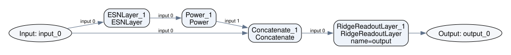

<span class="nb-kicker">Build · Architecture</span>

# power_augmented

The quadratic augmentation of [ott_esn](ott-esn.md), generalized: every
reservoir state is raised to a configurable `exponent` before the readout,
and the exponent becomes a hyperparameter you can sweep.

## Wiring

`Input → Reservoir → Power(exponent) → Concatenate(Input, Augmented) → Readout`

Two differences from `ott_esn`: the exponent is free rather than fixed
at 2, and `Power` transforms *every* state unit rather than every other
one. At `exponent=2.0` the readout sees only squared states plus the raw
input, where `ott_esn` interleaves squared and raw units. Whether full or
alternating augmentation works better is system-dependent and worth
comparing empirically on each problem.

<figure markdown>

<figcaption>Computation graph of the assembled model.</figcaption>
</figure>

## Use

```python
import torch
from resdag.models import power_augmented
from resdag.training import ESNTrainer

t = torch.arange(1401) * 0.05
series = torch.stack((t.sin(), t.cos(), (2 * t).sin()), dim=-1).unsqueeze(0)

model = power_augmented(
    reservoir_size=500, feedback_size=3, output_size=3,
    exponent=3.0, seed=7,               # odd exponents preserve state signs
)
ESNTrainer(model).fit(
    warmup_inputs=(series[:, :200],),
    train_inputs=(series[:, 200:1200],),
    targets={"output": series[:, 201:1201]},
)
model.eval()
preds = model.forecast(series[:, 1001:1201], horizon=200)  # (1, 200, 3)
truth = series[:, 1201:1401]                             # held-out continuation
```

Because `exponent` is continuous, the factory works directly as a
`model_creator` for [hyperparameter tuning](../../workflows/tune.md);
sweep `exponent` alongside `spectral_radius`.

!!! warning "Choose the exponent for signed states"
    `tanh` reservoir states span `[-1, 1]`, negatives and zeros included.
    Even integers (`2.0`) and odd integers (`3.0`, the default) are always
    safe. A *non-integer* exponent (`0.5`, `1.5`) on a negative state
    returns `nan`, and a *negative* exponent (`-1.0`) on a zero state
    returns `inf` — silently, since this factory uses the default
    `torch.pow`. If you need a non-integer exponent on signed states, wire
    the model by hand with
    [`Power(exponent, sign_preserving=True)`](../layers/transforms.md),
    which applies `sign(x) * abs(x) ** exponent`. Nonnegative exponents
    avoid the negative-state issue; negative exponents still need care at zero.

## Parameters

| Parameter | Default | Notes |
| --- | --- | --- |
| `reservoir_size`, `feedback_size`, `output_size` | required | units, input dim, output dim |
| `exponent` | `3.0` | power applied to every reservoir state; prefer integers on signed `tanh` states (see warning above) |
| `topology`, `feedback_initializer` | `None` | any [initialization spec](../initialization/index.md) |
| `spectral_radius`, `leak_rate` | `0.9`, `1.0` | factory scales the spectrum; `1.0` = no leak |
| `activation`, `bias`, `trainable` | `"tanh"`, `True`, `False` | reservoir options, as in the other factories |
| `readout_alpha`, `readout_bias`, `readout_name` | `1e-6`, `True`, `"output"` | ridge strength of the default [direct readout](../readouts/index.md); `readout_name` keys the targets dict |
| `**reservoir_kwargs` | — | forwarded to `ESNLayer` (e.g. `bias_scaling`) |

## Reference

None to cite directly — this is a ResDAG generalization of the quadratic
augmentation in Pathak et al., Phys. Rev. Lett. **120**, 024102 (2018),
not an architecture from the literature. If you publish results with it,
describe the augmentation explicitly rather than citing it as standard.

## See also

- [ott_esn](ott-esn.md) — the fixed quadratic, alternating-unit original.
- [Composing models](../index.md) — how layers are assembled into architectures.
- [Models reference](../../reference/models.md) — full factory signature.
