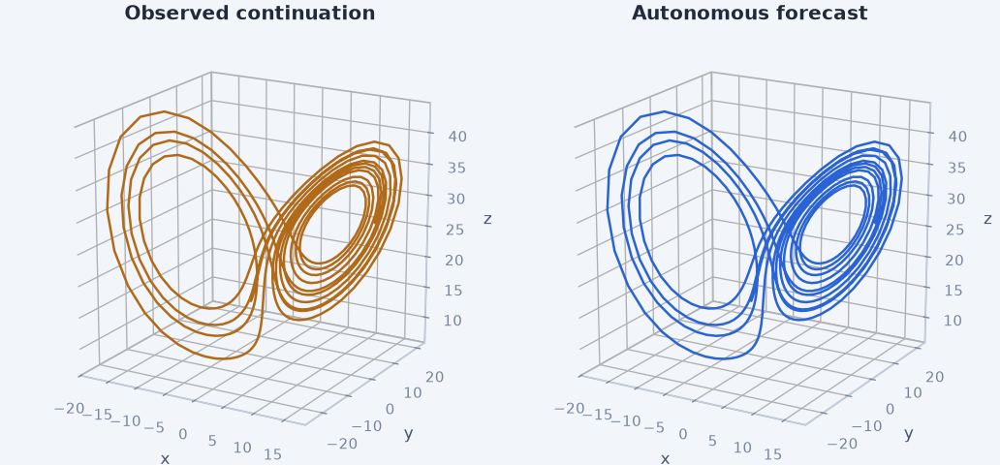

<span class="nb-kicker">Work · Forecast</span>

# Forecast

## Presets and named DAGs

`rd.ESN` and `rd.Model` forecast in the original signal units. Supply observed
history explicitly, or use the history retained by `fit`:

```python
import torch
import resdag as rd

observed = torch.sin(torch.linspace(0, 20, 400))[:, None]
model = rd.ESN(reservoir_size=32, washout=30, seed=7).fit(observed)
prediction = model.forecast(horizon=100)
resynchronized = model.forecast(history=observed, horizon=100)
assert prediction.shape == resynchronized.shape == (100, 1)
```

The first prediction estimates the sample immediately after the last
observation. Forecasts synchronize on their history and then feed predictions
back into the model; no future truth is needed. One output returns a tensor;
several named outputs return a dictionary. Trajectory-trained models return
TSDynamics trajectories unless `return_type="tensor"` is requested.

For custom networks, [named feedback connections](../start/feedback.md) route
outputs to chosen inputs with explicit delays. Prediction lead and connection
delay have separate controls. Inputs without feedback routes need known future
values through `future_inputs={"port": values}`. Temporal modules can use
[history execution](../advanced/forecast-capabilities.md) when they cannot
advance one frame at a time.

## Raw symbolic graphs

The lower-level examples below use `ESNModel` and raw factory results. Their
tensors use the graph's own units; they do not apply a surrounding `Model`'s
fitted scaling. `f_warmup`, `train`, `target` and `val` denote the aligned
splits from [`prepare_esn_data`](../reference/data.md). Use the
[common workflow](../start/model-workflow.md) unless you need to own this
preparation and state management yourself.

`forecast(observed, horizon=H)` predicts the `H` samples immediately after
an observed history. With next-sample targets, the last warmup readout already
estimates the first unseen sample. Slot zero uses it; each later prediction
feeds the previous prediction back into the reservoir.

### Anatomy

```python
preds = model.forecast(f_warmup, horizon=2000)  # (batch, 2000, features)
error = ((preds - val) ** 2).mean()             # prepared val aligns directly

full = model.forecast(f_warmup, horizon=2000, return_warmup=True)
# (batch, warmup_steps - 1 + 2000, features): no repeated boundary prediction
```

States reset by default. Pass `reset=False` to continue current states.
`horizon` must be a positive integer; `horizon=1` returns the immediate unseen
prediction. Multi-output models return a tuple; the first output supplies
feedback and must match the feedback input width.

An explicit `initial_feedback` supplies a distinct *additional observation*
after all warmup observations. The first output predicts the sample after that
seed. This is useful for continuing a rollout with empty warmup:

```python
more = model.forecast(
    f_warmup[:, :0],
    initial_feedback=preds[:, -1:],
    horizon=100,
    reset=False,
)
```

The final returned prediction has not been consumed yet. Passing it as the next
seed consumes it exactly once. With an explicit seed, including historical
predictions gives `warmup_steps + horizon` outputs.

### Driver alignment

Training pairs `(feedback_t, driver_t) → feedback_{t+1}`. Warmup supplies the
driver needed for forecast slot zero. The remaining `H-1` outputs need drivers
beginning immediately after the warmup driver window:

```python
N, horizon = 200, 300
preds = model.forecast(
    (x[:, :N], d[:, :N]),
    forecast_inputs=d[:, N:N+horizon-1],
    horizon=horizon,
)
truth = x[:, N:N+horizon]
```

A one-step forecast needs no future driver. Explicit seeds need `H` future
drivers, beginning at the seed's own time index. Extra trailing driver samples
are accepted and ignored. [Theory · Timing](../theory/timing.md) derives these
indices and explains continuation for driven models.

---

### Windowed reconstruction

`windowed_forecast()` fills the gaps in a sparsely-observed trajectory.
You hold the *full* ground-truth series but only trust it in periodic
windows; between them the model free-runs. Each cycle re-synchronizes the
reservoir on a short teacher-forced window, then forecasts across the
unobserved gap. Each new observed window can synchronize the state again,
limiting accumulated drift when the reservoir and observations support it.
This does not guarantee accurate reconstruction or an indefinite forecast.
The method loops over `forecast()` (inference uses `no_grad=True` by default):
the reservoir is reset once (on
the first window, and only when `reset=True`) and its state is carried
across the whole pass.

```text
[== warmup W ==][~~ gap P ~~][= teacher F =][~~ gap P ~~][= F =] ...
   observed        filled        observed       filled       obs
 (teacher-forced) (forecast)  (teacher-forced) (forecast)
```

<div class="nb-specimen" data-label="windowed_forecast.py" markdown>

```python
recon, mask = model.windowed_forecast(
    series,            # (batch, T, feedback_dim) ground truth
    predict_len=200,   # P: autonomous steps per gap
    teacher_len=40,    # F: real steps teacher-forced to re-sync
    warmup_len=200,    # initial sync window (defaults to teacher_len)
    return_mask=True,  # mask[t] True where observed, False where forecast
)
# recon: real values on observed steps, forecasts on the gaps.
# Score the steps the model never saw:
gap_rmse = ((recon[:, ~mask] - series[:, ~mask]) ** 2).mean().sqrt()
```

</div>

The returned `mask` is a 1-D boolean of length `T`: `True` on observed
(teacher-forced) steps and any untouched trailing remainder, `False` on
the forecast gaps. The gaps are *exactly* what you score —
`recon[:, ~mask]` against `series[:, ~mask]` — the values the model had to
infer without ever seeing them. Observed segments are copied verbatim, so
`recon[:, mask]` equals `series[:, mask]`.

For **driven models**, pass one full-timeline driver series per driver
*positionally*; each is sliced per cycle internally (unlike `forecast()`,
which takes separate warmup and forecast driver tuples):

```python
recon = model.windowed_forecast(feedback, driver, predict_len=100, teacher_len=50)
```

Keep `predict_len` short relative to the system's predictability horizon
(a few Lyapunov times for chaotic systems): sparse sampling still rebuilds
the attractor, but phase tracking degrades before the attractor *shape*
does. For multi-output models the first output is fed back, as in
`forecast()`, and only that channel is reconstructed.

---

## Coupled ensembles

A coupled ensemble runs N independently initialized models, trained
separately, in a single forecast loop: at every autoregressive step each
member receives the *same* aggregated output (mean, median, or a custom
module) as its next feedback. The shared signal couples the members. Their spread measures
member disagreement; it is not a calibrated uncertainty interval and need not
contain the true trajectory. Wrap the ensemble with `rd.Model(graph=ensemble)`
for the common original-unit workflow. The example below uses its raw API.

```python
import torch
import resdag as rd

ensemble = rd.coupled_ensemble_esn(
    n_models=5,
    model_factory=rd.classic_esn,   # default: rd.ott_esn
    aggregate="mean",               # "median" | nn.Module: (N, B, T, F) -> (B, T, F)
    seed=42,                        # sub-model i is built under seed + i
    reservoir_size=300, feedback_size=3, output_size=3,
)

ensemble.fit((warmup,), (train,), {"output": target})   # same contract as ESNTrainer
preds = ensemble.forecast(f_warmup, horizon=400)        # (batch, 400, 3)

agg, members = ensemble.forecast(f_warmup, horizon=400, return_individuals=True)
spread = torch.stack(members).std(dim=0)                # (batch, 400, 3)
```

`fit` trains each member independently on the same data — diversity comes
purely from the random initializations (`n_workers > 1` fits members in a
thread pool). If a member diverges mid-forecast, an outlier-filtering
aggregator excludes it from the shared signal:

```python
from resdag.ensemble.aggregators import OutliersFilteredMean

ensemble = rd.coupled_ensemble_esn(
    n_models=10,
    aggregate=OutliersFilteredMean(method="z_score", threshold=2.0),
    reservoir_size=300, feedback_size=3, output_size=3,
)
```

## How far you can forecast

For a chaotic system, small initial and modeling errors can grow rapidly.
A forecast that tracks the observed continuation for several Lyapunov times
may later lose pointwise alignment. Remaining bounded or tracing a similar
phase portrait does not establish accurate statistics or the correct invariant
measure; those require separate checks.

<figure markdown>

<figcaption>A fixed Lorenz display case from the independent-trajectory study.
Both panels include the entire recorded test window. The trajectory, reservoir
seed and forecast start were fixed before final evaluation. The
[complete results](../project/phase-five-robustness.md) report error thresholds
and accuracy across all cases; the picture alone does not measure accuracy.</figcaption>
</figure>

Use [TSDynamics plots and animations](visualize.md) to inspect component traces
and attractor geometry together.

If forecasts diverge early, compare hyperparameters on validation data
before increasing reservoir size. To quantify how far a forecast tracks —
and to report it in the hardware- and system-independent unit of Lyapunov
times — see [Work · Lyapunov time](lyapunov.md).

## Locking the forecast — golden regression fixtures

The forecast path is the library's most-revised code, so its behaviour is
pinned by committed *golden trajectories*. For every forecast-capable premade
model (`classic_esn`, `ott_esn`, `power_augmented`) plus an NG-RC forecaster, a
fully-seeded warmup → forecast on a canonical Lorenz-63 series is checked in
under `tests/fixtures/golden_forecast/` and asserted by
`tests/test_models/test_golden_forecast.py`:

- the first forecast steps must match the golden within a tight tolerance — the
  structural guard that catches any silent shift in the autoregressive loop
  (slot-0, the warmup/forecast seam, the flat single-step engine);
- the Valid Prediction Time against the true continuation must clear a committed
  floor — a coarser "forecast quality didn't collapse" guard.

If you intentionally change the forecast path (or the canonical data
generators), regenerate the goldens and review the diff:

```bash
python tools/regen_golden_forecasts.py --check   # verify only — write nothing (CI-style drift check)
python tools/regen_golden_forecasts.py --all     # rewrite every fixture
```

## Next

- [**Lyapunov time**](lyapunov.md) — score forecast quality and report horizons in Lyapunov times
- [**Tune**](tune.md) — hyperparameter optimization for forecast quality
- [Theory · Timing](../theory/timing.md) — derivation of every index in the forecast loop
