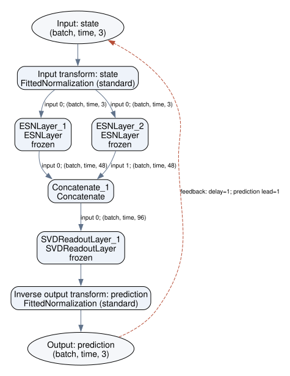

# Plot and animate a forecast

Use ResDAG for the model diagram and TSDynamics for trajectories, component
plots and movies. The examples below keep values in their original units.
A phase portrait shows geometry; use a time plot and an error measure to judge
whether predictions stay aligned with the observed continuation.

Install the Python visualization packages and Graphviz:

```sh
python -m pip install "resdag[dynamics,viz]" "tsdynamics[viz]"
# macOS: brew install graphviz
# Debian/Ubuntu: apt install graphviz
```

TSDynamics requires Python 3.12 or newer. GIF export uses Pillow through
Matplotlib. MP4 export also needs the FFmpeg executable on your path.

## Build a custom DAG and train it

Two reservoirs see the same observed state, with different memory rates.
Their states feed one shared readout. Each branch has an explicit seed.
The held-out continuation is sliced before fitting and is never used as a
training target.

```python
import torch
import tsdynamics as ts
import resdag as rd

trajectory = ts.systems.Lorenz(ic=[1, 1, 1]).run(final_time=70, dt=0.02)
training, truth = trajectory[500:3001], trajectory[3001:3501]

x = rd.reservoir_input(3, dtype=torch.float64)
seeds = rd.SeedStreams(7)
fast = rd.ESNLayer(
    48, feedback_size=3, spectral_radius=0.9, leak_rate=1.0,
    seed=seeds["fast"], dtype=torch.float64,
)(x)
slow = rd.ESNLayer(
    48, feedback_size=3, spectral_radius=0.9, leak_rate=0.25,
    seed=seeds["slow"], dtype=torch.float64,
)(x)
features = rd.Concatenate()(fast, slow)
y = rd.SVDReadoutLayer(96, 3, alpha=1e-6).double()(features)
model = rd.Model(inputs={"state": x}, outputs={"prediction": y}, washout=200)
model.fit(training)
prediction = model.forecast(history=training, horizon=len(truth))
```

These small branches illustrate composition. Their parameters are not a
validated long-range Lorenz recipe. For accuracy experiments, use
[separate validation data and repeated seeds](tune.md), then evaluate on a new
continuation. The [forecast experiment](../start/forecast-experiment.md) writes
model artifacts, exact split data, scores and a replay manifest.

## Draw or save the graph

```python
model.save("forecast-model.svg", rankdir="TB", show_trainable=True)
model.save("forecast-model.dot", rankdir="TB", show_trainable=True)
```

DOT is readable source and needs no Graphviz executable. The top-to-bottom
layout keeps both branches readable in the page. Use `rankdir="LR"` for a wide
left-to-right layout. In a notebook, display `model.plot_model()` directly. Diagrams include named
ports, feature widths, branches and feedback connections. Drawing does not
execute the model or advance recurrent state. The
[save and diagram guide](save-load.md#diagrams-and-formats) lists supported
formats and custom-component behavior.

<figure markdown>

<figcaption>Two reservoir branches merge before a common prediction head.
A diagram describes the computation; it does not establish forecast quality.</figcaption>
</figure>

## Compare the values over time

The model returns a TSDynamics trajectory because it was fitted on one.
Its future timestamps match the held-out continuation. Draw a component to
check phase drift and amplitude error:

```python
observed_x = ts.plot(truth, "time_series", components="x", color="#b06a18")
forecast_x = ts.plot(prediction, "time_series", components="x", color="#2a63d4")
comparison = ts.plot(
    observed_x, forecast_x,
    labels=["Observed continuation", "Autonomous forecast"],
)
comparison.save("forecast-x.png")
```

Change `components="x"` to another signal name. For an original-unit RMSE:

```python
error = torch.as_tensor(prediction.y) - torch.as_tensor(truth.y)
print(f"Forecast RMSE: {error.square().mean().sqrt().item():.4g}")
```

A single RMSE averages the whole window. The
[Lyapunov-time guide](lyapunov.md) measures how long the uninterrupted accurate
prefix lasts and explains how threshold and normalization affect that result.

## Save an attractor movie

`ts.plot` overlays the two recorded paths. Animation reveals those samples in
time order; it does not generate new observations or change the model's
forecast. Keep the full path with `trail(None)`:

```python
orbit = ts.plot(
    truth, prediction,
    labels=["Observed continuation", "Autonomous forecast"],
)
orbit.recolor("#b06a18", "#2a63d4").camera(elev=18, azim=-60)
orbit.save("forecast-phase.png", size=(960, 640))
movie = orbit.animate(duration=12, fps=24).trail(None)
movie.save("forecast.gif", size=(720, 480), dpi=100)
# movie.save("forecast.mp4", size=(960, 640), dpi=120)  # needs FFmpeg
```

`duration` is playback time in seconds; `dt` remains the physical interval
between recorded samples. More animation frames do not improve the prediction.
The camera is fixed and every forecast sample is retained, including divergence.

<figure markdown>
<video controls muted loop playsinline preload="none" width="960" height="640" poster="../../assets/figures/lorenz_forecast_poster.png" aria-label="Complete recorded Lorenz observation and forecast trajectories, revealed over time">
<source src="../../assets/figures/lorenz_forecast.mp4" type="video/mp4">
<a href="../../assets/figures/lorenz_forecast.mp4">Download the Lorenz forecast recording</a>.
</video>
<figcaption>Lorenz: a fixed display case from the independent-trajectory study.
The complete recorded test window is shown in original state coordinates.
Brown shows observations; blue shows the autonomous forecast.
<a href="../../assets/figures/lorenz_forecast_poster.png">Open the static image</a>.</figcaption>
</figure>

<figure markdown>
<video controls muted loop playsinline preload="none" width="960" height="640" poster="../../assets/figures/rossler_forecast_poster.png" aria-label="Complete recorded Rössler observation and forecast trajectories, including their later divergence">
<source src="../../assets/figures/rossler_forecast.mp4" type="video/mp4">
<a href="../../assets/figures/rossler_forecast.mp4">Download the Rössler forecast recording</a>.
</video>
<figcaption>Rössler: the corresponding fixed display case. A recognizable
attractor shape does not imply continued pointwise agreement. Brown shows
observations; blue shows the autonomous forecast.
<a href="../../assets/figures/rossler_forecast_poster.png">Open the static image</a>.</figcaption>
</figure>

Both displayed cases use final trajectory 0, reservoir seed 7849201 and forecast
start 0, chosen before observing final results. Each model's settings were
selected using separate validation trajectories. These cases illustrate the
recordings; the [complete study](../project/phase-five-robustness.md) reports
accuracy across all independent trajectories, initializations and starting
points. The [source observations, predictions and provenance](../assets/data/forecast-showcase-2026-10-24.json)
are downloadable. Documentation figure generation only reads those arrays; it
never refits models, selects a favorable test case or clips divergent paths.
